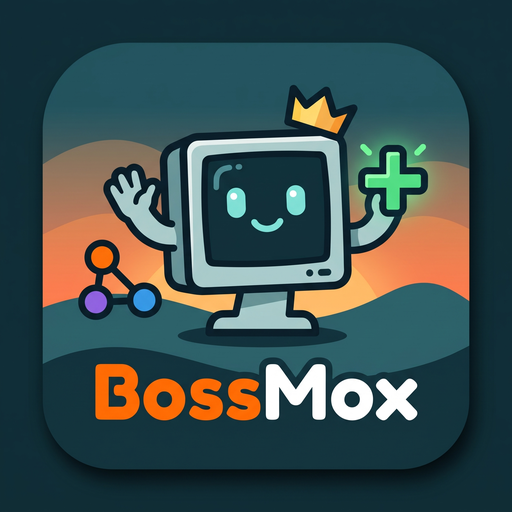
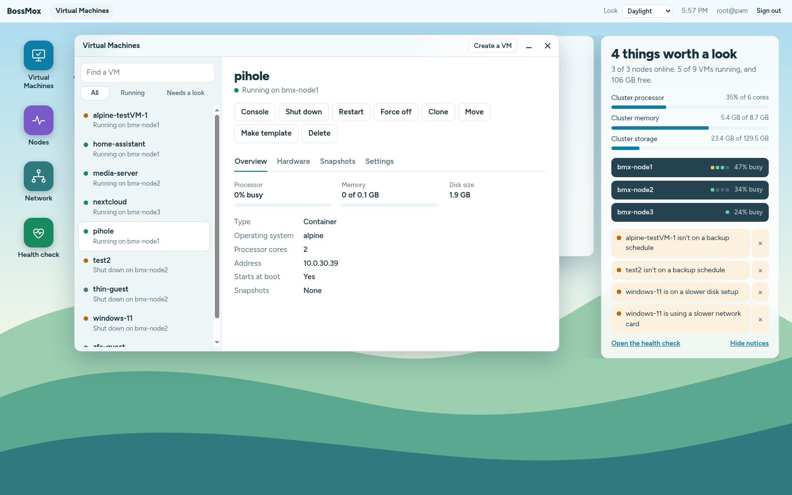
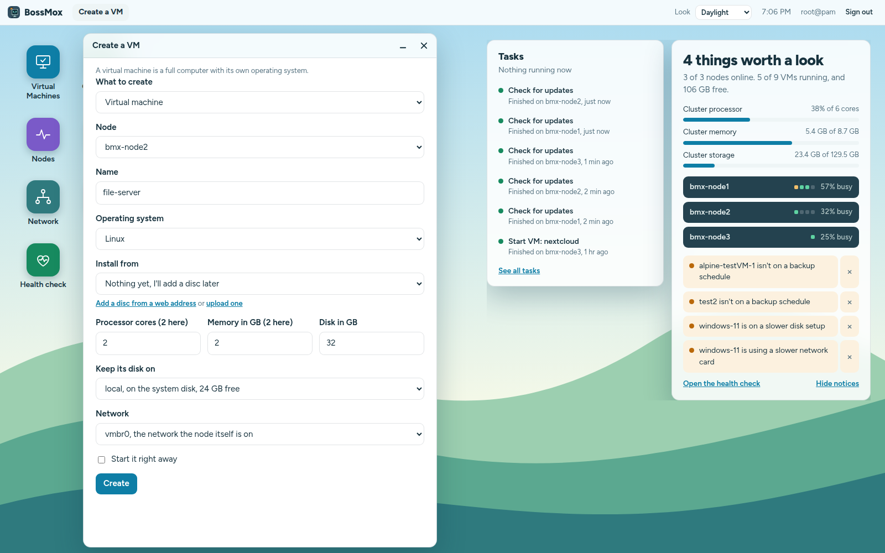
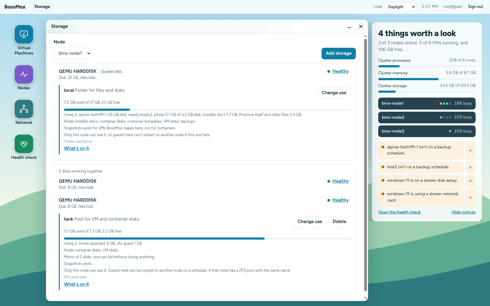
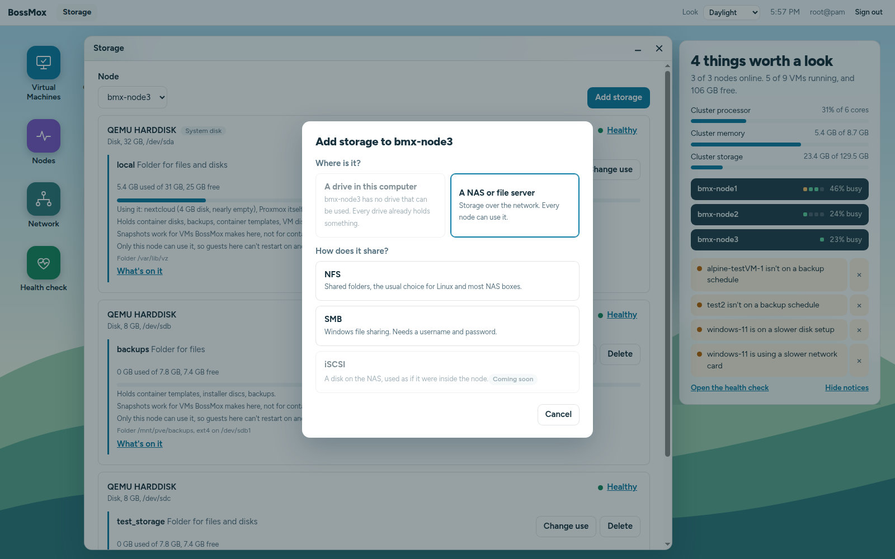
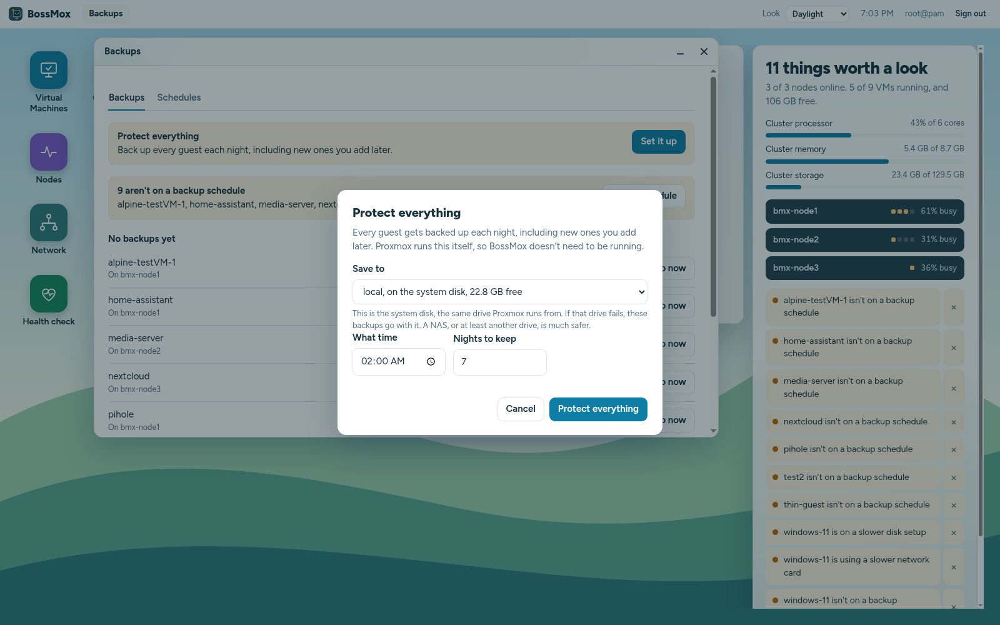
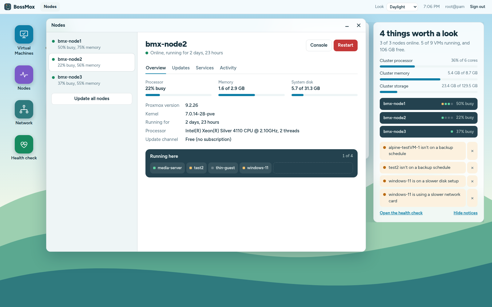
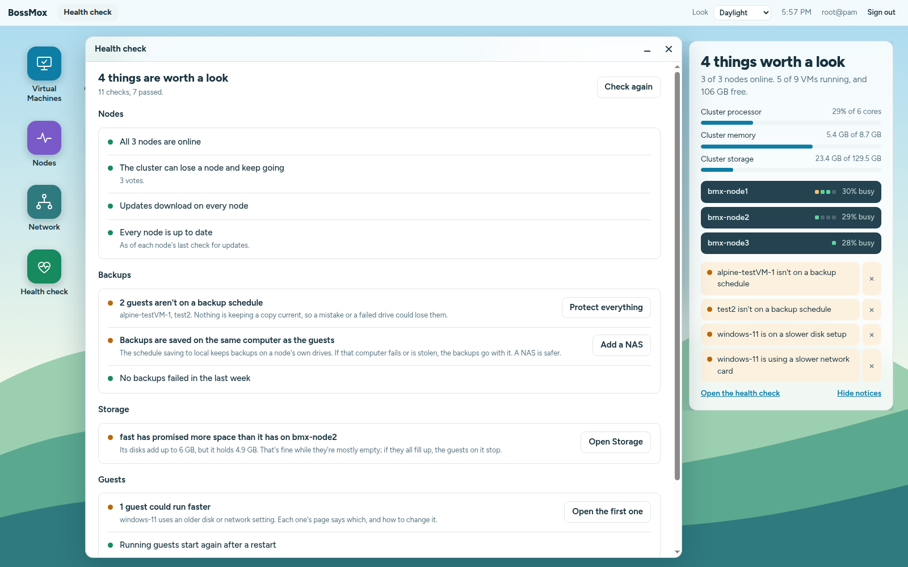
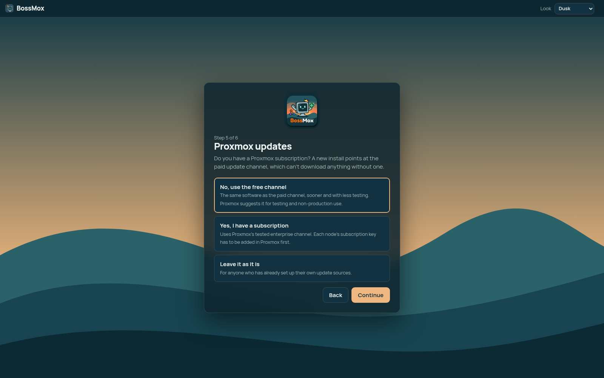
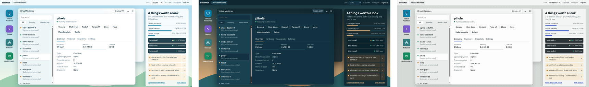

<p align="center"></p>

# BossMox

**BossMox: management app for Proxmox Virtual Environment.**

[](https://github.com/bossmox/bossmox/actions/workflows/test.yml)
[](LICENSE)


A desktop in your browser for running Proxmox VE, organized around what you came to do. It's for people who know Windows, Hyper-V or ESXi and would rather not learn Linux storage and networking words to run a home lab or a small office. Everyday tasks are in plain English, and BossMox checks for itself before it erases anything.



BossMox is an independent project. It is not affiliated with or endorsed by Proxmox Server Solutions GmbH. Proxmox is a registered trademark of Proxmox Server Solutions GmbH.

## Install

Run this as root on any Proxmox node, in the node's shell:

```sh
bash -c "$(curl -fsSL https://github.com/bossmox/bossmox/releases/latest/download/install.sh)"
```

It asks for a fixed address for BossMox, with the gateway filled in from the node (press Enter to let your router pick one instead, though that can change after a restart and break your bookmark). Then it shows what it will create and asks before doing anything. It makes one small VM (1 core, 256 MB of memory, 1 GB of disk), puts BossMox in it and changes nothing else on the node. It finishes by printing BossMox's address, a one-time setup code and the certificate's fingerprint. Open the address, check that the fingerprint your browser shows matches, enter the code, and a short setup wizard does the rest. Sign in with your normal Proxmox account from then on.

To set the address without being asked, for a script, add the options after `--`:

```sh
bash -c "$(curl -fsSL https://github.com/bossmox/bossmox/releases/latest/download/install.sh)" -- --ip 192.168.1.20/24 --gateway 192.168.1.1
```

Other options (`--storage`, `--bridge`, `--vlan`, `--vmid`) are listed at the top of [install.sh](deploy/install.sh). A reservation in your router's DHCP settings works too.

**Needs:** Proxmox VE 9 (tested on 9.2), a node that can reach the internet during the install, and a storage that holds VM disks. Proxmox VE 8 isn't tested yet.

## What it does

### Guests

Make VMs and containers from an installer disc or a template, start, stop, restart, open a console, change settings in plain words, add disks and network cards, take and roll back snapshots, clone, make templates, move to another node, and delete with an honest answer about whether a backup exists.


*Making a VM: every choice in plain words, down to which drive its disk goes on and which network it joins.*

### Storage as disks and pools

Each drive with the pools on it, what's using the space by name, whether snapshots work there and whether other nodes can use it. See what's on a pool and clean up leftovers BossMox can prove nothing uses.


*Two drives working together as a mirror, what's on each pool, and what each one can do.*

Add storage asks where it is and what it's for, then picks the type for you.


*Adding storage starts with a question anyone can answer. iSCSI is on its way.*

### Backups

Protect everything in one step with a nightly schedule that covers new guests too, back up now, restore as a copy or in place, and warnings when backups would sit on the same computer as the guests.


*One step to back up every guest each night, with a plain warning when the backups would sit on the system disk.*

### Nodes and updates

Switch to the free update channel in one click, check for and install updates in a live terminal, and update a whole cluster one node at a time, moving guests out of the way and back.


*A node at a glance: how busy it is, what version it runs, which update channel it's on, and what's running on it.*

### Health check

Every check BossMox can make, the passes included, with the fix for each problem one click away.


*Problems first, each with its fix, and the checks that passed, so you can see what healthy looks like.*

### Setup

A one-command install, a wizard that can build a cluster, and a question about your Proxmox subscription that sets the update channel for you.


*The setup wizard asks whether you have a subscription and sets Proxmox's updates to match. Free is the default.*

### Three looks

Daylight, Dusk and Workbench, picked in the top bar.



## This is a preview

It does a lot already, and everything in it is tested on a real Proxmox cluster, but there's more to come before a 1.0. What's next is on the [roadmap](ROADMAP.md): first cluster resilience (a backup heartbeat link, high availability, a tie-breaker for two nodes, and email alerts), then address changes, USB passthrough and adding nodes. Proxmox's own interface keeps working alongside BossMox for anything it doesn't cover yet.

Hardware security keys (WebAuthn) and recovery codes don't work in BossMox yet; authenticator-app codes do. The setup wizard needs a root account without 2FA.

## Keeping it safe

- BossMox signs you in with your Proxmox account and does everything as you, so Proxmox's own permissions apply. There's no back door: it can only do the actions written into it.
- Anything that erases or changes something asks you first and names it. BossMox checks for itself instead of trusting Proxmox to refuse, because sometimes Proxmox doesn't.
- Its VM has no logins. Setup is unlocked by a code shown only on its console, and the root password used during setup isn't kept.
- **Treat the BossMox VM like a node.** Every admin's password passes through it at sign-in, so only full admins should have any rights on it.

Found a security problem? Please report it privately; see [SECURITY.md](SECURITY.md).

## Updating, starting over, and removing it

BossMox checks GitHub for a new version every 6 hours and tells you on the desktop and in the health check. Each check tells GitHub this BossMox's internet address; you can turn it off in the health check.

To update, run this as root on the node that holds the BossMox VM. Your settings stay, everyone is signed out while it restarts, and if the new version doesn't start, the old one comes back:

```sh
bash -c "$(curl -fsSL https://github.com/bossmox/bossmox/releases/latest/download/update-bossmox.sh)"
```

To start setup again with a new code, run this on that node, with the VM's ID. Your nodes and guests aren't touched:

```sh
qm guest exec <VM ID> -- bossmox-reset
```

To remove BossMox completely: `qm destroy <VM ID> --purge 1`. Nothing else was changed, so nothing else needs undoing.

## Running it somewhere else

Docker, another machine, reverse proxies and development: see [docs/running-elsewhere.md](docs/running-elsewhere.md).

## How it's built

Rocky Lott directs BossMox: what it does, how it should feel to someone new to Proxmox, and what's good enough to ship. Claude, an AI model from Anthropic, writes much of the code.

That doesn't make it vibe-coded. Nothing goes in because it looks right; every change has to prove itself first, and you can check each part of that here:

- **Decided before it's built.** Each feature starts with a written decision record, including what was tried and didn't work. There are 33 so far, in [docs/adr](docs/adr).
- **Tested against real Proxmox.** Every feature runs on a three-node test cluster and a single-node install before release, and the screenshots above come from that cluster. When Proxmox turned out to do something risky without warning, such as deleting a disk a running VM still uses, BossMox got its own check instead of trusting it.
- **Tests that can fail.** Automated tests and a linter run on every change ([see the latest run](https://github.com/bossmox/bossmox/actions/workflows/test.yml)). The important ones are deliberately broken once, to prove they'd catch the mistake they're there for.
- **Reviewed by someone who didn't write it.** Seven reviews so far, each by AI reviewers that didn't write the code, reading it fresh; the latest two are summed up in [#42](https://github.com/bossmox/bossmox/issues/42). Their findings were fixed and each fix proven, apart from a few minor items still being worked on.
- **Libraries changed with care.** Updates to the parts BossMox depends on are tested on the cluster before they go in, never merged automatically.

## Contributing

Bug reports, ideas and pull requests are welcome. See [CONTRIBUTING.md](CONTRIBUTING.md) for how, and for the terms contributions come under, and [CODE_OF_CONDUCT.md](CODE_OF_CONDUCT.md).

## License

BossMox is free and open source under the [GNU Affero General Public License, version 3](LICENSE). You can use it, change it and share it. If you share a changed version, or run one for other people to use, you have to publish your changes under the same license.
